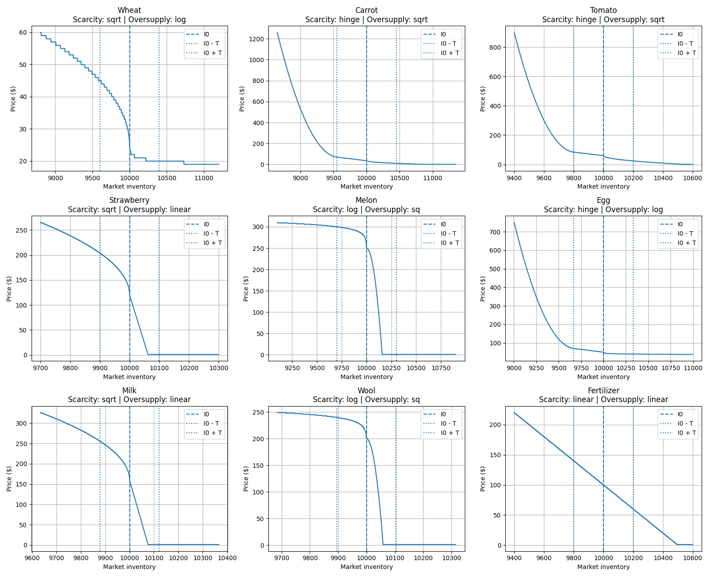

[English](game_mechanics_reference.md) | [Français](game_mechanics_reference.fr.md) | [简体中文](game_mechanics_reference.zh-CN.md)

[项目 README](../README.zh-CN.md)

# Kaggriculture — 游戏机制参考

用于智能体开发的主要机制、成本、生产速率、市场行为和约束条件的快速参考。

---

## 1. 生产

对于作物，**每格每日产量**是总收获量除以占用格子的天数，假设每日浇水并每日在峰值产量时收获。

对于动物，其稳态产量（`1 / interval`）是首次收获之后的稳定产出速率，只要动物存活，就会持续生产。

对于动物，**最大产量**对应于`max_held`，即在格子上可累积的最大未收获产品量。

|类型|产量类型|成本|基础价格|首次产量|最大产量年龄|后续产量|最大产量|行动成本|每格每日产量|
| ---------------- | ---------- | ---: | ---------: | ----------: | ------------: | ------------------------- | -----------------: | ------------------: | -----------------: |
|**小麦**|一次性|   10 |         25 |2天|4天|无|6（未施肥为4）|                   1 |               0.80 |
|**胡萝卜**|一次性|   20 |         35 |2天|3天|无|4（未施肥为3）|                   1 |               0.75 |
|**番茄**|持续性|   50 |         60 |8天|11天|每日×4|                  4 |                   1 |               0.33 |
|**草莓**|持续性|  100 |        120 |10天|16天|隔日×4|                  4 |                   1 |               0.24 |
|**西瓜**|一次性|   80 |        250 |10天|10天|无|                  6 |                   1 |               0.55 |
|**鹅 / 鸡蛋**|持续性|  300 |         50 |4天|不适用|每日无限期|4个持有|1 + 1建造鸡舍|               1.00 |
|**牛 / 牛奶**|持续性|  400 |        160 |8天|不适用|每2天无限期|6个持有|1 + 1建造牧场|               0.50 |
|**羊 / 毛**|持续性|  500 |        200 |6天|不适用|每3天无限期|6个持有|1 + 1建造牧场|               0.33 |
|**肥料**|不适用|  100 |X|不适用|不适用|不适用|不适用|                   1 |不适用|

### 作物具体说明

* **小麦**：未施肥时最大产量为4，施肥后为6。
* **胡萝卜**：未施肥时最大产量为3，施肥后为4。
* **西瓜**：增益窗口为6至12天。未施肥时在10天达到最大产量6，施肥后在8天达到最大产量6。
* **番茄**：在8、9、10和11天分别有4次计划产量，之后逐渐退化为杂草。
* **草莓**：在10、12、14和16天分别有4次计划产量，之后逐渐退化为杂草。

植物必须每日浇水。连续两天未浇水会使植物变为**杂草**。

一个新种植的种子从第一天开始就已经算作一次缺水，因此它必须在种植当天浇水，否则在当天结束时会变成杂草。

---

## 2. 动物

动物必须用 **小麦** 饲养。

连续两天没有食物会导致动物永久逃逸。

小麦可以在农场生产或以当前市场价格从市场购买。

### 动物护理

护理会为下一次计划生产积累一个奖励。

* 当动物在同一天既被喂食又得到护理时，会为其待定护理奖励增加 **+1**。
* 在下一次计划生产时，被喂食的动物会产出其基础产量加上累积的奖励。
* 奖励随后会被重置为0。
* 如果动物在生产日没有被喂食，将产出基础单位，但累积的奖励将丢失。
* 产量仍受限于 `max_held`。

### 观察到的护理奖励异常

在优化 `CARE` 行为时，观察到 **鹅** 存在一种无法解释的行为。

在测试场景中，鹅被放置在第1天，每天都被喂食，并在第5天收获：

|场景|第4天|观察到第6天的产量|
| -------- | ----- | -------------------------: |
|连续护理| `CARE` |2个蛋|
|第4天跳过护理|无 `CARE`|1个蛋|

这种行为与已记录的护理规则不一致。根据规则，累积的 `pending_care_bonus` 应在下一次计划生产时被消耗并重置为0。由于鹅在首次产量之后每天都会产蛋，因此第4天的护理奖励不应在中间生产后存活下来，从而影响第6天的产量。

目前尚不清楚确切原因。可能的解释包括每日结束时刷新、生产、护理奖励累积和重置的顺序，或环境中存在的一天索引/时间效应。在该行为完全解释之前，仅基于 `pending_care_bonus` 和 `max_held` 的护理优化应被视为不安全。

### 肥料生产

每只存活的动物每天都会产生 **1单位肥料**。

未收集的肥料不会累积。

---

## 3. 肥料

肥料可以通过动物生产或从市场购买获得。

重要作物效果：

|作物|无肥料|有肥料|
| ---------- | ------------------ | --------------- |
|**小麦**|最多4单位|最多6单位|
|**胡萝卜**|最多3单位|最多4单位|
|**西瓜**|10岁最大6单位|8岁最大6单位|

---

## 4. 农场基础设施

### 土地

农场被划分为5×5个区域。

额外区域成本：

|扩展|成本|
| --------- | ---------: |
|第1个| **$1,000** |
|第2个| **$2,000** |
|第3个| **$4,000** |
|**总计**| **$7,000** |

### 棚屋

最大容量：**100个非种子物品**。

种子不计入此限制。

---

## 5. 农场工人

农场工人是每天临时雇佣的工人。

他们的成本遵循斐波那契数列：

`cost = farmHandCostMult × fib(n)`

其中 `n` 是当天已雇佣的农场工人数量。

默认值 `farmHandCostMult = 1`：

|农场工人|成本|
| --------: | -----: |
|第1个|  **1** |
|第2个|  **1** |
|第3个|  **2** |
|第4个|  **3** |
|第5个|  **5** |
|第6个|  **8** |
|第7个| **13** |
|第8个| **21** |
|第9个| **34** |
|第10个| **55** |

雇佣成本序列在每天开始时重置。

---

## 6. 镇上商店

每3天解锁一个新的商店实例，且会替换旧实例，最多可有8个活跃实例。

每个商店实例每4个回合消耗其所需产品，相当于每天每种产品消耗6单位。单产品商店标记×2则每天消耗12单位。

|商店类型|增加需求的产品|
| --- | --- |
|**面包店**|鸡蛋、小麦|
|**披萨店**|牛奶、西红柿、小麦|
|**早餐店**|鸡蛋、小麦、草莓|
|**毛线店**|羊毛×2|
|**冰淇淋店**|草莓、牛奶、小麦|
|**宠物咖啡馆**|胡萝卜×2|
|**果汁店**|草莓、牛奶|
|**农贸市场**|小麦、胡萝卜、西红柿、草莓|

相同类型的商店实例需求会叠加。

---

## 7. 市场价格

有关完整的价格计算和市场曲线定义，请参阅 [价格函数](game_rules.zh-CN.md#the-price-function)

### 市场库存

`inventory` 代表资源的**全球市场库存**，而不是玩家农场上存储的数量。

市场库存随着产品进入或离开市场而变化：

* 玩家出售的产品会**增加**市场库存。
* 玩家从市场购买的产品会**减少**市场库存。
* 镇上商店的消费会**减少**市场库存。
* 市场库存在整个游戏过程中持续存在。

一般行为：

* `inventory < I0` → 稀缺 → **价格上涨**
* `inventory = I0` → 均衡 → **基础价格**
* `inventory > I0` → 过剩 → **价格下降**
* 最低市场价格 → **1美元**

市场库存距离 `I0` 越远，价格变化就越大，具体变化遵循该资源的特定市场曲线。

### 市场行为摘要

|资源|稀缺|过剩|关键行为|
| -------------- | --------------------------------- | ----------------------- | --------------------------------- |
|**小麦**|初期增长迅速|下降缓慢|对过剩具有抗性|
|**胡萝卜**|在强烈稀缺下加速增长|快速下降|具有强烈稀缺潜力|
|**西红柿**|在强烈稀缺下加速增长|快速下降|强稀缺性潜力|
|**草莓**|快速上升|非常快速下降|对过剩供应极为敏感|
|**瓜**|缓慢上升|极端快速下降|对过剩供应极为敏感|
|**蛋**|在强稀缺条件下加速增长|缓慢下降|对过剩供应具有抗性|
|**牛奶**|快速上升|非常快速下降|对过剩供应极为敏感|
|**羊毛**|缓慢上升|极端快速下降|对过剩供应极为敏感|
|**肥料**|常规上升|常规下降|可预测|

对于 **胡萝卜、番茄和蛋**，当市场稀缺性变得显著时，价格可急剧上涨。

对于 **草莓、瓜、牛奶和羊毛**，过剩供应可迅速将市场价格推至 **1美元** 的底部。

### 市场价格曲线

---

## 8. 关键限制

|机制|限制|
| --------------------- | -------------------------------------------------------------------- |
|**植物**|连续两天无水 → 长出杂草|
|**动物**|连续两天无小麦 → 永久失去|
|**动物肥料**|每只存活动物每天仅1个，不累积|
|**动物护理**|喂养和护理天数累积，用于下一次生产奖励|
|**动物生产**|未收获的产量受限于 `max_held`|
|**棚屋**|最多容纳100个非种子物品|
|**土地**|扩展成本为 $1,000 → $2,000 → 4000美元|
|**高端产品**|草莓、瓜、牛奶和羊毛对过剩供应极为脆弱|
|**关键产品**|胡萝卜、番茄和蛋在强稀缺条件下可急剧上涨|
|**镇上商店**|商店构成会直接改变需求|
